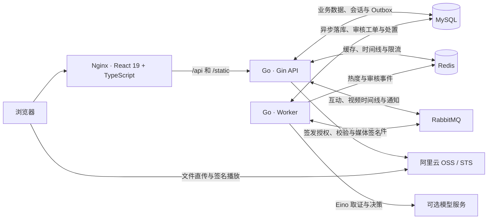

# feedsystem_video_go

一个 Go + React 短视频应用。用户可以浏览热榜和关注流、发布视频、参与评论和私信，并通过通知查看互动及举报处理结果。后端由 Gin API 和独立 Worker 两个进程组成，使用 MySQL、Redis 和 RabbitMQ。公开部署支持阿里云 OSS 直传与签名播放、HTTPS Cookie 会话，以及基于 Eino 的评论审核 Agent。

## 快速启动

安装 Docker 和 Docker Compose 后，在仓库根目录启动开发栈并检查 API 健康状态。

```bash
docker compose up -d --build --wait
docker compose ps
curl -fsS http://127.0.0.1:5173/api/healthz
```

| 入口 | 默认地址 |
| --- | --- |
| React 应用 | <http://127.0.0.1:5173> |
| Gin API（直连） | <http://127.0.0.1:8080> |
| RabbitMQ 管理台 | <http://127.0.0.1:15672>（开发账号见 [.env.example](.env.example)） |

首次启动后，在网页注册并通过 `/video` 发布第一个视频，点击“查看作品”验证播放，再回到首页确认作品出现在 Feed 中。开发栈默认使用本地上传，无需 OSS 或模型密钥。需要覆盖开发配置时，将 [.env.example](.env.example) 复制为根目录的 `.env`。排查启动问题可运行 `docker compose logs --tail=100 backend worker`。

## 系统架构



| 链路 | 实现 |
| --- | --- |
| Feed 与播放 | 提供最新、关注、点赞排行、热榜和话题查询。Redis 加速时间线和热榜，MySQL 支持回源。热榜支持快照分页，公开 Feed 支持游客浏览。 |
| 发布与媒体 | 作品和时间线 Outbox 在同一 MySQL 事务提交，API 进程内的发布器与消费者通过 RabbitMQ 更新 Redis 时间线。开发环境支持本地分片续传。启用 OSS 后，浏览器用短期 STS 凭据直传私有 Bucket，API 校验实际文件，发布时绑定资产 ID。作品和头像保留稳定站内路径，访问时由 API 按需签发媒体地址，历史本地媒体继续走 `/static`。 |
| 互动与通知 | API 受理视频点赞、评论和关注，独立 Worker 消费 RabbitMQ 事件并更新数据库或热度。API 内的通知消费者持久化通知并通过 SSE 推送。评论支持线程、回复、点赞和 `@username` 提及，私信按联系人查看。 |
| 账号与会话 | 支持注册、登录、个人主页、资料编辑和头像。开发栈沿用 JWT 和刷新令牌协议，公开 HTTPS 入口使用 HttpOnly 刷新 Cookie、MySQL 会话和短期 Bearer access token。 |

### 评论审核

1. 用户举报评论后，API 在同一事务写入举报与审核 Outbox。Worker 投递 RabbitMQ 事件并幂等建单，使用数据库租约领取模型评估任务。
2. Eino Agent 基于脱敏证据判断，可调用只读工具补证，并通过终结工具提交折叠或转人工意图。模型默认以影子模式运行。仅明确营销评论可进入自动折叠流程，须有有效终结意图、置信度至少 0.90，并通过证据、放量和校准检查。未满足自动处置条件的工单由审核员处理。
3. 审核员在 `/moderation` 查看证据及处置记录，可维持现状、折叠、恢复展示或确认删除。折叠评论排在可见评论之后，读者可主动展开。举报者通过通知和 `/reports/:id` 查看进度及结果。

未配置模型时，审核员可以在“待处理”队列手动审单。使用真实模型时，在 Worker 环境配置 `MODERATION_MODEL`、`MODERATION_API_KEY` 和对应的 `MODERATION_MODEL_BASE_URL`。审核员账号授权、运行模式和隔离验收见 [评论审核文档](docs/moderation/index.md)。

## 本地开发

源码开发使用 Go 1.26+、Node.js 24 和 Docker Compose。先在仓库根目录启动中间件并等待就绪。

```bash
docker compose up -d --wait mysql redis rabbitmq
```

再从仓库根目录分别执行以下三组命令。先等 API 启动完成数据库迁移，再运行 Worker。

```bash
# 终端 1 · API
cd backend
CONFIG_PATH=configs/config.compose-local.yaml go run ./cmd
```

```bash
# 终端 2 · Worker
cd backend
CONFIG_PATH=configs/config.compose-local.yaml go run ./cmd/worker
```

```bash
# 终端 3 · React 接入本地 Go API
cd frontend
npm ci
API_PROXY_TARGET=http://127.0.0.1:8080 npm exec vite -- --mode test --port 5173 --strictPort
```

本机 Go 进程读取 `backend/.env` 或当前终端的环境变量。自定义中间件账号或密码时，确保 Go 进程与 Compose 使用同一配置。

只预览界面时，在 `frontend/` 执行 `npm run dev`，使用本地片源和模拟 API。真实 OSS 联调使用 `npm run dev:oss`（默认端口 5174）。代理及构建变量见 [前端开发说明](frontend/README.md) 和 [OSS 直传 API](backend/OSS_UPLOAD_API.md)。

## API 与代码入口

浏览器通过 Nginx 的 `/api` 前缀请求后端。直连 Gin 时去掉该前缀。下表列出各模块的代表接口。

| 模块 | 接口 |
| --- | --- |
| 会话 | `POST /account/login`、`/account/refresh`、`/account/logout` |
| Feed | `POST /feed/listLatest`、`/feed/listByPopularity`、`/feed/listByFollowing`、`/feed/listLikesCount`、`/feed/listByTag` |
| 上传与播放 | `POST /video/publish`，本地模式使用 `/video/chunk/*`，OSS 模式使用 `POST /uploads`、`GET /media/assets/:id` 等接口 |
| 评论 | `POST /comment/listThreads`、`/comment/listReplies`、`/comment/publish`、`/comment/setLike`、`/comment/reveal` |
| 举报与审核 | `POST /report/create`、`/report/get`、`/moderation/list`、`/moderation/decide`，`GET /moderation/stream` |
| 点赞、关注、私信与通知 | `POST /like/like`、`/social/follow`、`/message/send`、`/notification/list`，`GET /notification/stream` |

| 代码 | 职责 |
| --- | --- |
| [backend/cmd](backend/cmd) | API、独立 Worker 与审核离线评测的进程入口 |
| [backend/internal/http/router.go](backend/internal/http/router.go) | API 路由、鉴权与进程内消费者装配 |
| [backend/internal](backend/internal) | 账号、视频、Feed、社交、私信、上传、审核和中间件 |
| [frontend/src/react](frontend/src/react) · [frontend/src/api](frontend/src/api) | React 页面、播放器、审核台和 API 客户端 |
| [deploy](deploy) | 生产镜像构建、HTTPS 配置、部署验收与回滚 |

## 生产部署与验证

- 生产 Compose 使用固定发布镜像，预发布默认仅在 `127.0.0.1:15174` 提供前端入口。生产 API 的 `/readyz` 检查 MySQL、Redis 和 RabbitMQ，预发布可通过 Nginx 访问 `/api/readyz`。pprof 在生产环境关闭，在本机源码开发配置中分别监听 `localhost:6060`（API）和 `localhost:6061`（Worker）。[生产 Compose](compose.production.yml)
- [deploy/compose.public.yml](deploy/compose.public.yml) 提供公开 HTTPS 入口。按 [生产环境变量模板](deploy/.env.production.example) 配置，并同步启用前端与后端的 OSS 直传和 HTTPS Cookie 会话。运维步骤见 [发布与回滚手册](deploy/README.md)，协议细节见 [OSS 直传 API](backend/OSS_UPLOAD_API.md) 与 [HTTPS Cookie 会话](backend/SESSION_API.md)。

以下命令从仓库根目录运行，覆盖代码检查、测试和离线审核冒烟。

```bash
(cd backend && go vet ./... && go test -race -count=1 ./...)
(cd frontend && npm ci && npx playwright install --with-deps chromium webkit && npm run verify)
(cd backend && go run ./cmd/moderation-eval -scripted -input internal/moderation/testdata/eval-smoke.jsonl)
```

[主 CI](.github/workflows/ci.yml) 还检查依赖、生产镜像、会话、媒体 Range 和 Compose 部署。[审核端到端工作流](.github/workflows/moderation-e2e.yml) 使用隔离的 MySQL、Redis 和 RabbitMQ 验证举报到处置的链路。
